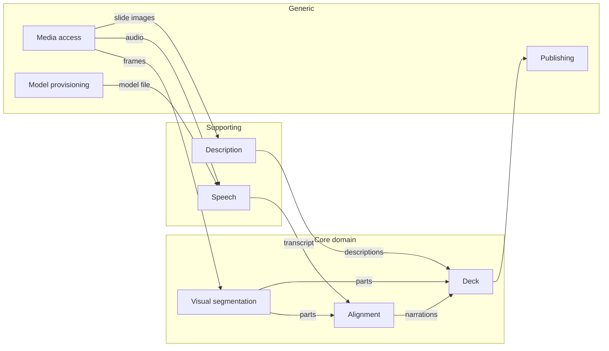

# deckscribe design

deckscribe turns a recorded talk into a **deck**: the slides that were shown,
what was said over each, and optionally a description of each slide. This
document fixes the vocabulary, splits the problem into bounded contexts, and
maps them onto code. It describes the target structure; the "Today" table at
the end maps the current flat modules onto it.

## Ubiquitous language

Terms used the same way in code, docs, flags and output.

| Term | Meaning |
|---|---|
| **Recording** | The input video file: a picture track and a sound track. |
| **Instant** / **Span** | A time in the recording, in seconds; a half-open range of instants. |
| **Frame** | A small grayscale picture of the recording at an instant (480×300, 5 per second). Analysis only; never shown. |
| **Change map** | For two consecutive frames, how much of each 10×10 block changed. |
| **Thumbnail** | A 96×60 summary of a frame, kept for every frame. |
| **Cut** | An instant where most of the picture changes at once (camera switch, layout change, full slide change). |
| **Stretch** | The span between two cuts. Has one layout. |
| **Overlay** | A region that keeps changing whatever the slide does: webcam, burned-in captions, speaker panel. |
| **Mask** | The overlays of a stretch, as blocks to ignore. |
| **Layout** | What a stretch shows: `Slides` (still picture, maybe with overlays) or `Live` (camera, demo, video clip). |
| **Hold** | A span of at least the minimum length where the masked picture stays still. |
| **Slide** | One or more holds showing the same picture, with the instant its image is taken from. |
| **Live part** | A live stretch long enough to stand on its own; no slide. |
| **Part** | A slide or a live part. The parts of a deck tile the whole recording. |
| **Word** | A spoken word with its span. |
| **Transcript** | All words of a recording, in order. |
| **Piece** | A stretch of audio given to the recognizer at once (≤ 30 s, cut at a quiet moment). |
| **Narration** | The words whose midpoint falls inside a part. |
| **Description** | Title, text and visuals of a slide, read from its image. |
| **Deck** | The result: ordered parts, each with its span, image, narration and description. |

## Bounded contexts



| Context | Kind | Owns | Depends on (through ports) |
|---|---|---|---|
| **Visual segmentation** | core | frames → change maps, thumbnails → cuts → stretches → overlays, layouts → holds → slides and live parts | a source of frames |
| **Alignment** | core | narration of each part from the transcript | nothing |
| **Deck** | core | the deck aggregate and its invariants | nothing |
| **Speech** | supporting | pieces, transcript | a recognizer, a source of audio |
| **Description** | supporting, optional | the prompt, painting out overlays, parsing the reply | a vision model, an image source |
| **Media access** | generic | decoding frames and audio, extracting a still at an instant, preparing images | the ffmpeg program |
| **Model provisioning** | generic | finding, downloading and verifying the speech model | HTTP, file system |
| **Publishing** | generic | rendering a deck as markdown, JSON, later subtitles | file system |

Visual segmentation is where deckscribe differs from other tools; it gets the
most care, the most tests and no I/O. Speech and Description wrap outside
engines and should stay thin.

### Deck invariants

- Parts are ordered and tile the recording: the first starts at 0, each starts
  where the previous ends, the last ends at the recording's duration.
- A slide's image instant lies inside its own span.
- Every word belongs to exactly one part's narration.
- Only slides have descriptions.

## Ports and adapters

The domain sees traits; adapters implement them. Each adapter sits behind a
Cargo feature when it brings a heavy dependency.

| Port | Used by | Adapter | Feature |
|---|---|---|---|
| `FrameSource` — frames of a recording, in order | Visual segmentation | ffmpeg pipe | — |
| `AudioSource` — 16 kHz mono samples | Speech | ffmpeg pipe | — |
| `StillSource` — full-resolution image at an instant | Deck assembly, Description | ffmpeg seek | — |
| `Recognizer` — words with spans for a piece | Speech | transcribe.cpp (Parakeet) | `transcribe` |
| `ModelStore` — a local model file | Speech | Hugging Face download + SHA-256 | `transcribe` |
| `Describer` — description of a slide image | Description | OpenAI-compatible chat API | `describe` |
| `DeckWriter` — persist a deck | Publishing | markdown, JSON | — |

Tests use in-memory adapters: synthetic frames (a still slide, a moving
webcam blob, changing captions, a pan, a camera cut) and canned words. That
covers the synthetic-video idea without encoding video.

## Application layer

One use case, **Scribe a recording**:

1. Start the picture lane (frames → visual segmentation) and, if enabled, the
   sound lane (audio → speech) on separate threads.
2. Build parts; take each slide's still image.
3. If both lanes ran, align words into narrations.
4. If enabled, describe slides.
5. Assemble the deck, check its invariants, hand it to the writers.

All thresholds live in one `Settings` value (cut 0.6, overlay frequency 0.4,
overlay max share 0.4, hold change 0.05, merge 0.02, minimum hold 6 s, piece
30 s, mask widening 4 blocks). The CLI fills it from flags; the benchmark
harness fills it from a sweep.

### What can be switched off

| Switch | Effect | Type |
|---|---|---|
| `--no-slides` | sound lane only: transcript, no images | run time |
| `--no-transcript` | picture lane only: no model download, no GPU | run time |
| `--no-mask`, `--mask x,y,w,h` | overlay finding off, or extra boxes | run time |
| `--no-split` | one stretch for the whole recording | run time |
| `--no-live-parts` | live stretches fold into the next slide | run time |
| `--describe-url` | descriptions on (off by default) | run time |
| `--format md,json` | which writers run | run time |
| `transcribe` | builds transcribe.cpp (CMake, C++, GPU backend) | build time, default on |
| `describe` | builds the HTTP client | build time, default on |

At least one lane must be on. Without `transcribe` the build is pure Rust.

## Code layout

A Cargo workspace, so the compiler enforces the dependency direction: the
core crate cannot reach an adapter.

```
crates/
  deckscribe-core/          pure domain, no I/O, depends on serde only
    src/time.rs             Instant, Span
    src/frames.rs           Frame, ChangeMap, Thumbnail, FrameFeatures
    src/segmentation/       cuts, stretches, overlays, holds, parts
    src/speech.rs           Word, Transcript, piece planning
    src/alignment.rs        narration
    src/deck.rs             Deck, Part, Slide, LivePart, Description; invariants
    src/settings.rs         Settings with all thresholds
    src/ports.rs            FrameSource, AudioSource, StillSource, Recognizer,
                            ModelStore, Describer, DeckWriter
  deckscribe/               application, adapters, CLI (lib + bin)
    src/app.rs              scribe a recording
    src/adapters/ffmpeg.rs
    src/adapters/transcribe_cpp.rs      feature "transcribe"
    src/adapters/model_store.rs         feature "transcribe"
    src/adapters/openai_vision.rs       feature "describe"
    src/adapters/output/{markdown,json}.rs
    src/main.rs             flags → Settings, adapters → app
bench/                      scoring against LPM and M3AV; data not included
docs/
flake.nix                   package, overlay, dev shell, checks
```

## Packaging

- The committed `flake.nix` is the product's: `packages.default` (ffmpeg
  wrapped in, no model inside), an overlay, `devShells.default` for
  contributors, and `checks` (build, tests, clippy, fmt). It follows
  `github:NixOS/nixpkgs/nixos-unstable` with its own `flake.lock`, and builds
  for x86_64 and aarch64 Linux (Vulkan) and aarch64 macOS (Metal).
- Personal tooling lives outside the repo, in the bare clone's `flake/`,
  loaded by the worktree's `.envrc` through `source_up_if_exists`.
- Release binaries come from CI for macOS arm64, Linux x86_64 and arm64, and
  Windows x64; `cargo install` works but needs CMake and a GPU SDK.
- The speech model is never shipped. It is downloaded on first use from a
  pinned revision and verified; `--model` uses any local file.

## Decisions

| Decision | Why |
|---|---|
| Call the ffmpeg program, not its libraries | Same dependency under Nix, no version coupling with the bindings, ~30 lines per pipe. Only `adapters/ffmpeg.rs` would change. |
| transcribe.cpp with Parakeet TDT v2 | Per-word timestamps, 44× realtime on the iGPU, consistent punctuation; the same engine Hex ships on three platforms. |
| Our own visual segmentation | Scene-detection tools cut on every webcam blink; masks per stretch and still-hold detection are the core value. Scored F1 0.85 on hand-annotated lectures. |
| Descriptions through any OpenAI-compatible server | No model bundled; works with llama.cpp, Ollama, LM Studio, hosted APIs. |
| Images taken 1 s before a hold ends | Analysis frames and ffmpeg seeking can disagree by a fraction of a second; the last still frame sometimes came back as the next slide. |

## Today

The current code is one crate with flat modules. Mapping onto the target:

| Today | Target |
|---|---|
| `media.rs` | `adapters/ffmpeg.rs` (+ `FrameSource`, `AudioSource`, `StillSource`) |
| `frames.rs` | `core/frames.rs` |
| `segments.rs`, `overlays.rs`, `holds.rs` | `core/segmentation/` |
| `transcribe.rs` (pieces, per-slide) | `core/speech.rs`, `core/alignment.rs` |
| `transcribe.rs` (engine calls) | `adapters/transcribe_cpp.rs` |
| `model.rs` | `adapters/model_store.rs` |
| `describe.rs` | `adapters/openai_vision.rs` + prompt and parsing in core |
| `main.rs` (flags) | `main.rs` |
| `main.rs` (running stages) | `app.rs` |
| `main.rs` (writing files) | `adapters/output/` |
| constants in four files | `core/settings.rs` |
